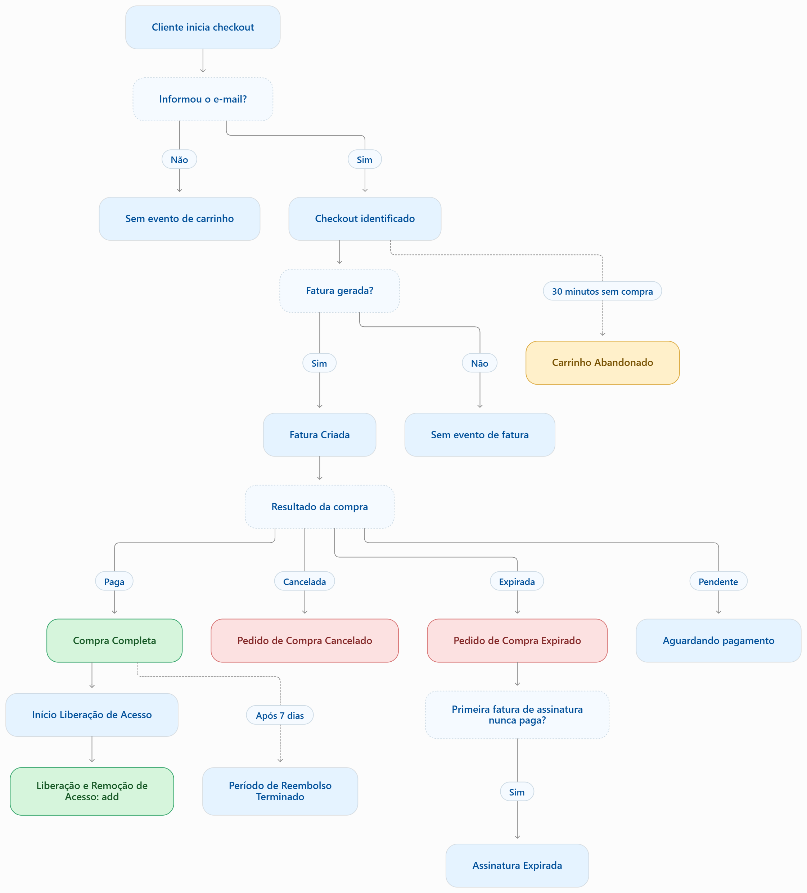
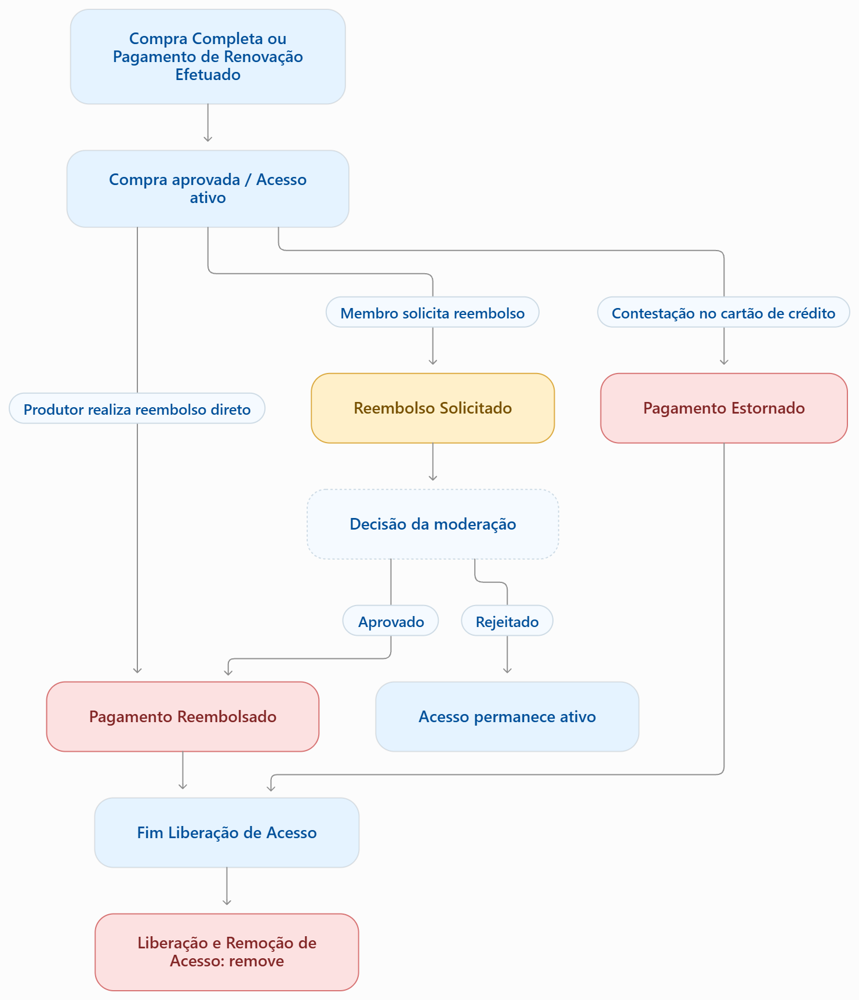
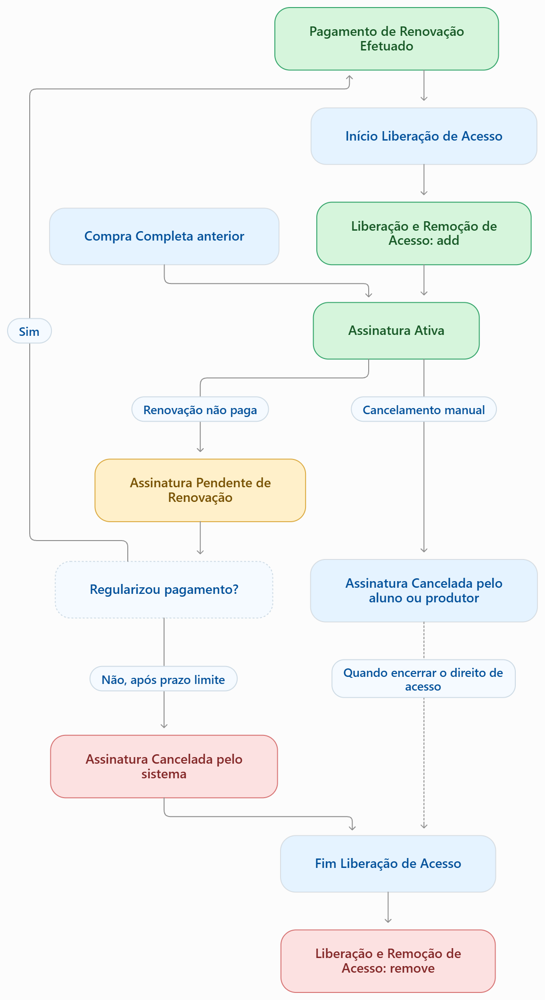
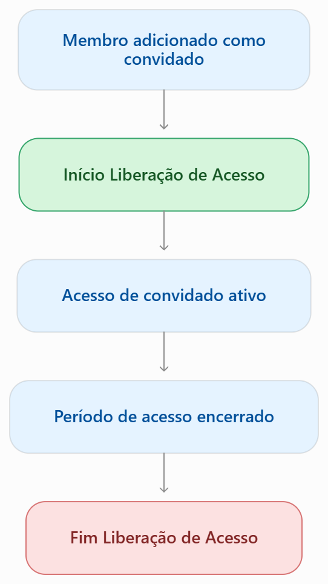

# Jornada dos eventos

Esta página mostra **como os webhooks se encadeiam**: o que acontece antes, o que dispara o quê e quais eventos nunca aparecem juntos. Para a regra exata de cada evento, consulte [Gatilhos dos eventos](./gatilhos-dos-eventos.md); para os campos, abra o artigo do evento.

A jornada se divide em quatro fluxos:

1. [Checkout e primeira compra](#1-checkout-e-primeira-compra)
2. [Reembolso, estorno e encerramento de acesso](#2-reembolso-estorno-e-encerramento-de-acesso)
3. [Assinatura e renovação](#3-assinatura-e-renovação)
4. [Acesso de convidados](#4-acesso-de-convidados)

Ao final, a [matriz de disparos](#matriz-de-disparos) resume qual evento leva a qual.

:::tip Como ler os fluxos
Cada caixa é um webhook. Caixas tracejadas são decisões, não eventos. Os fluxos não são exclusivos: uma mesma pessoa pode passar por mais de um ao longo do tempo, e um mesmo fato de negócio pode gerar mais de um webhook (por exemplo, uma compra aprovada gera Compra Completa, Início liberação de acesso e Liberação e remoção de acesso).
:::

## 1. Checkout e primeira compra

### Como ler este fluxo

| Evento | Quando acontece |
| --- | --- |
| [Carrinho Abandonado](./eventos/carrinho-abandonado.md) | A pessoa chegou ao checkout, informou ao menos o **e-mail** e ficou **30 minutos sem concluir a compra**. Se não informou o e-mail, não há evento de carrinho. |
| [Fatura Criada](./eventos/fatura-gerada.mdx) | Uma cobrança foi gerada, **independentemente de ser paga**. |
| [Compra Completa](./eventos/compra-aprovada.mdx) | A fatura criada foi **paga**: é a primeira compra aprovada. |
| [Pedido de Compra Cancelado](./eventos/compra-cancelada.mdx) | A fatura ou o pedido foi cancelado. |
| [Pedido de Compra Expirada](./eventos/pedido-de-compra-expirado.mdx) | O pedido passou do prazo de validade sem pagamento. |
| [Assinatura Expirada](./eventos/assinatura-expirada.mdx) | A primeira fatura de uma assinatura **nunca foi paga** e a assinatura expirou. |
| [Período de Reembolso Terminado](./eventos/periodo-de-reembolso-terminado.mdx) | O prazo de garantia terminou após a Compra Completa. Não se repete nas renovações. |

### Pontos de atenção

- **Carrinho Abandonado não é, necessariamente, o primeiro webhook.** Ele só existe se a pessoa não comprou e depende da janela de inatividade. Já a Fatura Criada pode acontecer antes dessa janela, e os dois podem coexistir.
- **Quem compra não recebe Carrinho Abandonado.**
- **Compra Completa dispara, em seguida,** [Início liberação de acesso](./eventos/inicio-liberacao-de-acesso.mdx) e [Liberação e remoção de acesso](./eventos/liberacao-e-remocao-de-acesso.mdx) com a ação `Add`.
- **Exemplo:** a pessoa informa o e-mail, gera uma fatura e só paga 40 minutos depois. O Carrinho Abandonado pode já ter sido enviado aos 30 minutos, e a Compra Completa chega aos 40. As duas notificações são coerentes entre si.
- **Período de Reembolso Terminado** depende do prazo de garantia configurado no produto (7, 15 ou 30 dias). O fluxo acima ilustra o caso de 7 dias.

## 2. Reembolso, estorno e encerramento de acesso

Este fluxo **começa sempre em um pagamento aprovado**: uma Compra Completa ou um Pagamento de Renovação Efetuado.

### Como ler este fluxo

| Evento | Quando acontece |
| --- | --- |
| [Reembolso solicitado](./eventos/reembolso-solicitado.mdx) | O **membro** pede o reembolso e o pedido segue para avaliação. Só existe para compras já aprovadas. |
| [Pagamento Reembolsado](./eventos/pagamento-reembolsado.mdx) | O reembolso foi realizado. Pode vir de uma solicitação aprovada ou de um reembolso direto, feito pelo produtor, **sem solicitação anterior**. |
| [Pagamento Estornado](./eventos/pagamento-estornado.mdx) | O pagamento foi estornado por contestação (chargeback) ou disputa perdida. Só existe para compras já aprovadas. |

### Pontos de atenção

- **Reembolso solicitado não encerra o acesso.** Ele apenas inicia a avaliação. Se o pedido for rejeitado, o acesso permanece ativo e nenhum outro evento é enviado por causa dele.
- **Pagamento Reembolsado e Pagamento Estornado encerram o acesso:** disparam [Fim liberação de acesso](./eventos/fim-liberacao-de-acesso.md), seguido de Liberação e remoção de acesso com a ação `Remove`.
- Nem toda contestação gera Pagamento Estornado. Veja as condições em [Pagamento Estornado](./eventos/pagamento-estornado.mdx).

## 3. Assinatura e renovação

Uma renovação só existe se houve **uma Compra Completa antes**.

### Como ler este fluxo

| Evento | Situação |
| --- | --- |
| [Assinatura Pendente de Renovação](./eventos/assinatura-pendente-de-renovacao.mdx) | Uma assinatura que estava ativa passou a precisar de um novo pagamento. |
| [Pagamento de Renovação Efetuado](./eventos/pagamento-de-renovacao-efetuado.mdx) | A renovação foi paga. Isso acontece logo após a assinatura ser regularizada. |
| [Assinatura Cancelada](./eventos/assinatura-cancelada.mdx) | Cancelamento pelo aluno, pelo produtor ou pelo sistema, por falta de pagamento. |
| [Assinatura Expirada](./eventos/assinatura-expirada.mdx) | Assinatura **inicial** que nunca foi paga e cuja validade terminou. |

### Pontos de atenção

- **Renovação paga:** após o Pagamento de Renovação Efetuado, a pessoa continua com acesso, e a assinatura volta ao estado ativo.
- **Renovação não paga:** a assinatura passa por **Pendente de Renovação**. Se for regularizada, o caminho é o da renovação paga. Se o prazo limite passar sem pagamento, a assinatura é cancelada pelo sistema, e o acesso é encerrado com Fim liberação de acesso e Liberação e remoção de acesso com `Remove`.
- **Cancelamento manual** (pelo aluno ou pelo produtor): o acesso só é removido quando o direito de acesso termina. Cancelar a assinatura não significa, por si só, remover o acesso na hora.
- **Pendente de Renovação x Assinatura Expirada:** a primeira vale para assinaturas que já estiveram ativas; a segunda, para assinaturas cuja primeira fatura nunca foi paga.

## 4. Acesso de convidados

Este fluxo é **independente**: não depende de fatura, compra ou assinatura.

- [Início liberação de acesso](./eventos/inicio-liberacao-de-acesso.mdx) é enviado quando o membro é **adicionado como convidado**.
- [Fim liberação de acesso](./eventos/fim-liberacao-de-acesso.md) é enviado quando o **acesso do convidado encerra**.

## Matriz de disparos

| Evento de origem | Eventos que acontecem em sequência |
| --- | --- |
| Compra Completa | Início liberação de acesso → Liberação e remoção de acesso (`Add`) |
| Pagamento de Renovação Efetuado | Início liberação de acesso → Liberação e remoção de acesso (`Add`) |
| Pagamento Reembolsado | Fim liberação de acesso → Liberação e remoção de acesso (`Remove`) |
| Pagamento Estornado | Fim liberação de acesso → Liberação e remoção de acesso (`Remove`) |
| Assinatura Pendente de Renovação, não regularizada após o prazo limite | Assinatura Cancelada → Fim liberação de acesso → Liberação e remoção de acesso (`Remove`) |
| Prazo de acesso encerrado | Fim liberação de acesso → Liberação e remoção de acesso (`Remove`) |
| Convidado adicionado | Início liberação de acesso |
| Acesso de convidado encerrado | Fim liberação de acesso |

## Como usar isso na sua integração

Trate os webhooks como **notificações de transição de estado**, e não como comandos.

Um único pagamento aprovado pode gerar **três notificações** para o mesmo fato de negócio: Compra Completa, Início liberação de acesso e Liberação e remoção de acesso (`Add`). Cada uma tem seu próprio identificador e referencia o mesmo pagamento.

- **Não processe a mesma mudança duas vezes.** Se você consome os eventos de acesso e também os de compra, defina qual deles libera ou remove o acesso na sua plataforma.
- **Associe os eventos ao pagamento e à assinatura corretos,** usando os identificadores do payload, como `Data.Purchase.PaymentId` e `Data.Subscriptions[].Id`.
- **Não use a pendência ou o cancelamento da assinatura, isoladamente, para remover um acesso ainda válido.** Os eventos de acesso comunicam a mudança efetiva.

Veja também [Regras](./regras.md) e [Retentativas](./retentativas.md).

:::note Evento sem fluxo
**Notificar Membro Ativo** não faz parte desta jornada: não há disparador em produção. Veja [Gatilhos dos eventos](./gatilhos-dos-eventos.md).
:::
